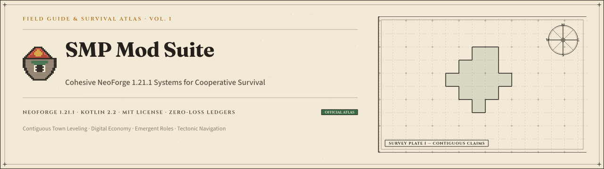
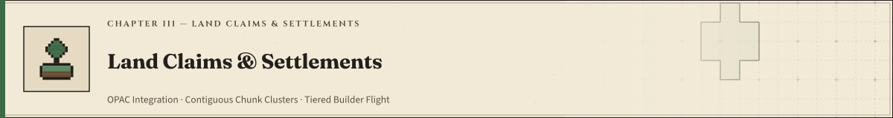
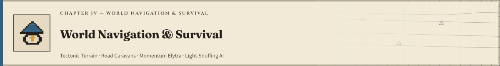
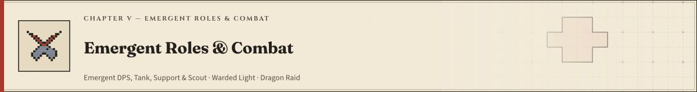
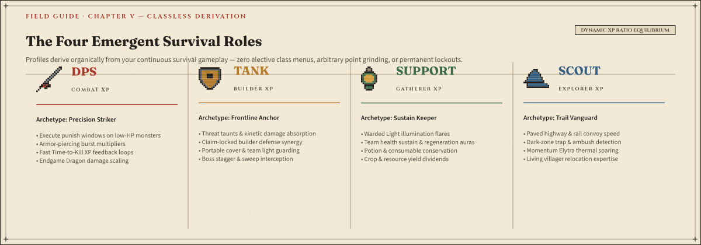

# SMP Mod Suite (`smpmod`)



[](https://github.com/rylanmoseley/smp-mod/actions/workflows/build.yml)
[](https://github.com/rylanmoseley/smp-mod/actions/workflows/modpack.yml)

A high-cohesion Minecraft server mod suite built for **NeoForge 1.21.1** in **Kotlin** using **Kotlin for Forge (KFF)**.

Based on the [Technical Architecture and Systems Overview (v2.0)](./design-v2.md), this mod suite re-engineers survival multiplayer gameplay loops around three fundamental design pillars:
1. **Maximize Social, Constructive, and Long-Term Multiplayer Gameplay:** Bases grow stronger when players build together. Contiguous settlement clusters pool defensive buffs, proximity voice chat fosters natural cooperation, and items accumulate permanent historical lore reflecting who crafted, found, or traded them.
2. **Eliminate Low-Reward Grinding and Unrecoverable Loss:** Dying no longer means losing hundreds of hours of gear in lava or despawn timers. Valuable gear routes into an escalating buyback ledger with wall-clock decay, while automated AFK farm boxes (iron/villager/raid chutes) are replaced by buffed deep-cave veins, active dungeon loot, and repeatable milestone rewards.
3. **Rebalance Playstyles into Meaningful Endgame Roles:** Zero elective class-selection menus or arbitrary point allocations. A player's combat profile (**DPS**, **Tank**, **Support**, or **Scout**) is calculated automatically from the continuous ratio of what they actually do in survival.

---

## Subsystems & Architecture Overview

The SMP Mod Suite is structured into six cohesive chapters that work together to replace repetitive grinding with cooperative survival gameplay:

### Chapter I: Economy & Commerce

Non-material digital currency safe from death drops. Fed by repeatable milestone advancements, natural block harvest faucets, variety-based construction dividends, P2P commerce, living villager encapsulation, anti-1x1 mobility restocks, and a server bulk store.  
*Read the [Economy & Commerce Guide](./docs/economy-and-commerce.md).*

### Chapter II: Death Recovery & Item Lore

Named, enchanted, and high-tier items receive persistent UUIDs and track `Crafted by` / `Owned by` lore. On death, items route to a buyback ledger with escalating fees, a 24-hour exclusive owner window, and ~30-day fee decay before entering the public marketplace.  
*Read the [Death Recovery & Item Lore Guide](./docs/death-recovery-and-item-lore.md).*

### Chapter III: Land Claims & Settlements

Integrated with **Open Parties and Claims (OPAC)**. Allows noncontiguous claim parcels across the world, while strictly evaluating settlement tiers, pooled defensive buffs, and temporary builder flight per **contiguous chunk cluster** via BFS analysis.  
*Read the [Land Claims & Building Guide](./docs/land-claims-and-building.md).*

### Chapter IV: World Navigation & Survival

Integrates with **Tectonic** alpine terrain and underground rivers. Blocks Nether roof transit, adds road convoy speed bonuses, gates Elytra behind exploration milestones with momentum gliding, and introduces dynamic light-snuffing mob AI.  
*Read the [World Navigation & Survival Guide](./docs/world-navigation-and-survival.md).*

### Chapter V: Emergent Roles & Combat

Dynamic Playstyle XP tracking ($\text{Combat}$, $\text{Builder}$, $\text{Gatherer}$, $\text{Explorer}$) continuously calculates role specializations (**DPS**, **Tank**, **Support**, **Scout**). Features support Warded Light flares and a multi-phase cooperative Ender Dragon raid.  
*Read the [Emergent Roles & Combat Guide](./docs/emergent-roles-and-combat.md).*



### Chapter VI: Server Utilities & Moderation

Real-time stat leaderboards (`/leaderboard` across 9 categories), Vanilla Tweaks tool stats lore counters, multiplayer dynamic percentage sleep with sunrise announcements, and an asynchronous Java 21 Discord webhook dispatcher.  
*Read the [Server Moderation & Utilities Guide](./docs/server-moderation-and-utilities.md).*

---

## Detailed Systems Documentation

Comprehensive guides covering every major mechanic, in-game command, and tuning dial are available in the **[`docs/`](./docs/README.md)** directory:

- **[Economy & Commerce Guide](./docs/economy-and-commerce.md):** Currency minting, milestone faucets, harvest shop unlocks, villager encapsulation, and bulk stores.
- **[Death Recovery & Item Lore Guide](./docs/death-recovery-and-item-lore.md):** UUID buyback ledgers, fee escalation, 30-day decay, public market auctions, and item provenance.
- **[Land Claims & Building Guide](./docs/land-claims-and-building.md):** OPAC integration, contiguous settlement tiers, variety-weighted block scoring, and builder flight.
- **[World Navigation & Survival Guide](./docs/world-navigation-and-survival.md):** Tectonic mountain survival, Nether transit hazards, road caravans, and momentum Elytra flight.
- **[Emergent Roles & Combat Guide](./docs/emergent-roles-and-combat.md):** Playstyle XP formulas, combat role profiles, dark-zone elite traits, and the Ender Dragon encounter.
- **[Server Moderation & Utilities Guide](./docs/server-moderation-and-utilities.md):** Stat leaderboards, tool stats counters, multiplayer sleep, and Discord webhook notifications.
- **[Configuration & Tuning Matrix](./docs/configuration-and-tuning.md):** Administrator reference for all parameters in `config/smpmod-common.toml`.

---

## Development Environment & Toolchain

- **Target Game Version:** Minecraft `1.21.1`
- **Mod Loader:** NeoForge `21.1.234+`
- **Language:** Kotlin `2.2.20` via Kotlin for Forge `5.10.0+`
- **Gradle Plugin:** `net.neoforged.moddev` (ModDevGradle `2.0.142`)
- **JVM Target:** Java 21 (`JavaLanguageVersion.of(21)`)
- **Mappings:** Official Mojang Mappings + Parchment (`2024.11.17`)

### Building the Project Locally

Run standard Gradle tasks via the wrapper:

```bash
# Build the mod JAR
./gradlew build

# Run Minecraft Client with the mod
./gradlew runClient

# Run Dedicated Server with the mod
./gradlew runServer

# Run Data Generation (recipes, tags, models)
./gradlew runData
```

---

## Server Deployment & Modpack Distribution

- **Dedicated Server Operations:** Full production guides, tuned `server.properties`, Java 21 G1GC launch scripts (`run.sh` / `run.bat`), Chunky pre-generation runbooks, and LuckPerms permission trees are documented in **[`./server/`](./server/README.md)**.
- **Proxmox VE Auto-Sync:** Automated deployment scripts, systemd units, and turnkey sync tools for Proxmox virtual machines are documented in **[`./server/proxmox/`](./server/proxmox/README.md)**.
- **Client Modpack (Packwiz & Modrinth):** Client distribution is managed in **[`./pack/`](./pack/README.md)** using [Packwiz](https://packwiz.github.io/). Export to Modrinth (`.mrpack`) or CurseForge (`.zip`) with one command, or let the GitHub Actions CI automatically attach bundles to releases.

---

## Contributing

We welcome community contributions! Please review our **[Contributing Guide](./CONTRIBUTING.md)** for details on:
- Standard Git Flow branching conventions (`main`, `develop`, `feat/*`, `fix/*`)
- Conventional Commits message formatting
- Code style guidelines and pull request submissions

---

## License

This project is licensed under the [MIT License](./LICENSE).
