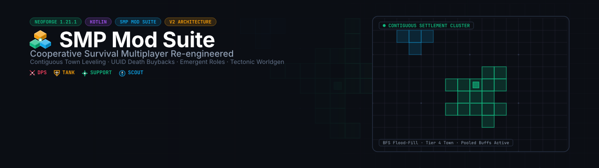

# SMP Mod Suite: Player Survival Handbook & Systems Documentation



Welcome to the comprehensive player and administrator guide for the **SMP Mod Suite**. 

This mod suite reimagines standard survival multiplayer into a deeply cooperative, constructive, and fair survival experience. It removes low-reward repetitive grinding and unrecoverable catastrophic loss, while rebalancing building, gathering, exploring, and combat so every playstyle carries direct strategic value into the endgame.

---

## Systems Documentation Overview

The documentation is organized into focused, user-facing guides covering every major mechanic:

| Guide | Core Systems Covered | Target Playstyles |
| :--- | :--- | :--- |
| **[Economy & Commerce](./economy-and-commerce.md)** | Digital off-inventory currency, one-time starter & repeatable milestone advancements, per-block natural harvest shop unlocks, server bulk store, living villager relocation & anti-1x1 mobility restocks, and active anti-AFK resource channels. | Gatherers, Traders, Crafters |
| **[Death Recovery & Item Lore](./death-recovery-and-item-lore.md)** | Ownership-bound UUID buybacks, cumulative death cost escalation, ~30-day fee decay, 24-hour exclusive window $\rightarrow$ 1.25x public marketplace listing, anti-theft protections, and persistent provenance Item Lore (`Crafted by` / `Owned by`). | All Players, Combatants |
| **[Land Claims & Building](./land-claims-and-building.md)** | Open Parties and Claims (OPAC) integration, noncontiguous claims across the world, contiguous settlement cluster partitioning, variety-weighted block scoring, recurring construction dividends, nonresident settlement tourism, pooled defensive buffs, and claim-locked temporary builder flight. | Builders, Town Founders, Architects |
| **[World Navigation & Survival](./world-navigation-and-survival.md)** | Tectonic Everest worldgen & alpine summits, dangerous Nether transit & roof lockout, Overworld biome mobility bonuses, Explorer-gated momentum glider Elytra (no mid-air rocket spam), spatial light avoidance AI, `destroys_light_on_aggro` mob traits, and repurposed safe-haven villages. | Explorers, Scouts, Navigators |
| **[Emergent Roles & Combat](./emergent-roles-and-combat.md)** | Zero elective class selection, dynamic Playstyle XP tracking (Combat, Builder, Gatherer, Explorer), emergent role profile derivation (**DPS**, **Tank**, **Support**, **Scout**), Warded Light flares, and the cooperative Ender Dragon encounter. | Fighters, Dungeon Crawlers, Raid Teams |
| **[Server Moderation & Utilities](./server-moderation-and-utilities.md)** | Real-time stat leaderboards (`/leaderboard`), Vanilla Tweaks tool stats lore counters, multiplayer dynamic sleep with sanctuary buffs, async Java 21 Discord webhook dispatcher, and production companion stack guide. | All Players, Server Admins, Community Leads |
| **[Configuration & Tuning](./configuration-and-tuning.md)** | Server administration reference, configuration options, tuning matrix constants, and balance variables. | Server Admins, Modpack Authors |

---

## Foundational Design Pillars

Every system in the suite is built around three core pillars from the [Technical Architecture Specification](../design-v2.md):

```
       ┌─────────────────────────────────────────────────────────────┐
       │                 SMP Mod Suite Architecture                  │
       └──────────────────────────────┬──────────────────────────────┘
                                      │
          ┌───────────────────────────┼───────────────────────────┐
          │                           │                           │
          ▼                           ▼                           ▼
┌───────────────────┐       ┌───────────────────┐       ┌───────────────────┐
│ 1. Social & Long- │       │ 2. Fair Recovery  │       │ 3. Strategic Role │
│    Term Play      │       │    & Low Grind    │       │    Balance        │
│                   │       │                   │       │                   │
│ • Contiguous      │       │ • Digital wallet  │       │ • Zero elective   │
│   town leveling   │       │ • UUID buybacks   │       │   classes         │
│ • Pooled claim    │       │ • 30-day fee      │       │ • Playstyle XP    │
│   defensive buffs │       │   decay           │       │   ratios          │
│ • Provenance item │       │ • Bulk store for  │       │ • Active caving & │
│   lore tracking   │       │   common drops    │       │   dungeon tomes   │
│ • Proximity voice │       │ • Anti-AFK farm   │       │ • Cooperative     │
│   integration     │       │   sinks           │       │   Ender Dragon    │
└───────────────────┘       └───────────────────┘       └───────────────────┘
```

1. **Maximize Social, Constructive, and Long-Term Multiplayer Gameplay:**  
   Bases grow stronger when players build together. Contiguous settlement clusters pool defensive buffs, proximity voice chat fosters natural cooperation, and items accumulate permanent historical lore reflecting who crafted, found, or traded them.

2. **Eliminate Low-Reward Grinding and Unrecoverable Loss:**  
   Dying no longer means losing hundreds of hours of gear in lava or despawn timers. Valuable gear routes into an escalating buyback ledger with wall-clock decay, while automated AFK farm boxes (iron/villager/raid chutes) are replaced by buffed deep-cave veins, active dungeon loot, and repeatable milestone rewards.

3. **Rebalance Playstyles into Meaningful Endgame Roles:**  
   There are no class-selection menus or arbitrary point allocations. Your combat profile (**DPS**, **Tank**, **Support**, or **Scout**) is calculated automatically from the continuous ratio of what you actually do in survival. Builders naturally emerge as Tanks, Gatherers as Support, Explorers as Scouts, and Hunters as DPS specialists.

---

## Quick-Start Commands & Key Interactions

| Action | How to Access in Game |
| :--- | :--- |
| **Check Digital Balance** | Run `/economy balance` or open your Player Status HUD. |
| **Pay Another Player** | Run `/economy pay <player> <amount>` (applies configured server trade tax). |
| **Browse Bounty Board** | Run `/bounty list` to browse objective contracts, `/bounty accept <id>`, and `/bounty claim <id>`. |
| **Town Treasury & Upgrades** | Stand in your claim and run `/town balance`, `/town tourism`, `/town deposit <amount>`, `/town upgrades`, or `/town upgrade buy <id>`. |
| **Encapsulate Villager** | Sneak + Right-Click an adult villager as an Explorer (Scout role or 100+ Explorer XP) to package into a tradable spawn specimen. |
| **Open Buyback Ledger** | Run `/buyback` or visit any designated Town Recovery Terminal. |
| **Browse Public Market** | Run `/buyback public` to view items unclaimed after 24 hours (1.25x markup). |
| **View Playstyle XP & Role** | Run `/role profile` to inspect your Combat, Builder, Gatherer, and Explorer affinities. |
| **Check Stat Leaderboards** | Run `/leaderboard <category> [page]` or `/top <category>` to view server rankings across 9 survival metrics. |
| **Claim Land** | Open the Open Parties and Claims (OPAC) map screen (`'` key by default) or run `/claims claim`. |
| **Inspect Claim Level** | Stand inside a claim and run `/claims cluster` to view the contiguous settlement tier and pooled buffs. |
| **Activate Builder Flight** | Place blocks continuously within an owned or shared contiguous claim cluster (~5s grace window). |
| **Caravan Speed Transit** | Group with 2+ players or lead pack animals along recognized roads and railways for Speed I/II. |
| **Town Alarm Bell** | Ring a village or settlement Bell (`Blocks.BELL`) to broadcast an acoustic alert up to 96m and highlight hostiles. |
