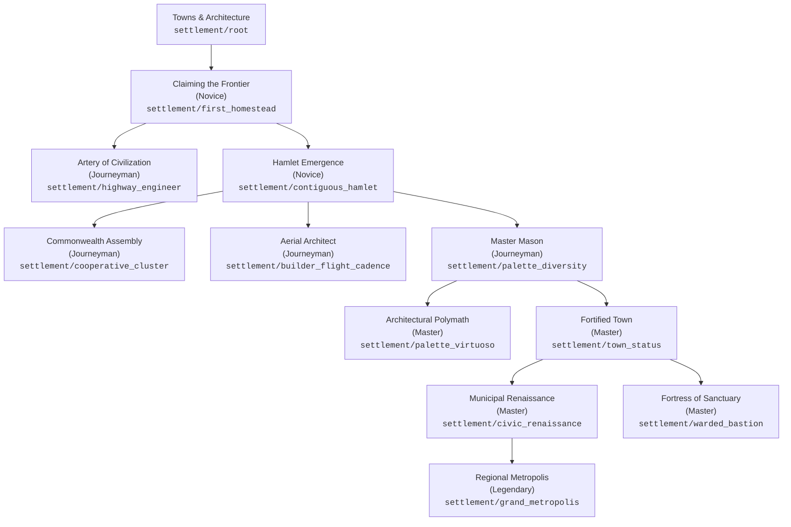

# Land Claims & Construction System

The land claiming and construction system empowers cooperative town building, fortified settlements, and aesthetic construction without the risk of passive leeching or disconnected outpost stat-farming.

---

## 1. Noncontiguous Claims vs. Contiguous Settlement Clusters

Unlike traditional land claim systems that either force rigid contiguous shapes or allow disconnected chunks to share stat bonuses, the SMP Mod Suite balances freedom and realism:

```
                World Dimension Map (Example Player Claims)
    
       Contiguous Cluster A (Main City)         Disconnected Outpost B
       ┌───┬───┬───┬───┐                               ┌───┐
       │ C │ C │ C │ C │                               │ C │ (Mining Camp)
       ├───┼───┼───┼───┤                               └───┘
       │ C │ C │ C │ C │ ➔ Metropolis Tier                   ➔ Outpost Tier
       ├───┼───┼───┼───┤   (High Dev Level,                   (Independent Dev
       │ C │ C │ C │ C │    Full Pooled Buffs,                 Level 1, Minimal
       ├───┼───┼───┼───┤    Builder Flight)                    Buffs)
       │ C │ C │ C │ C │
       └───┴───┴───┴───┘
```

### Noncontiguous Freedom
* Players and parties are free to claim chunks anywhere across the world—such as a remote mountain observatory, a Nether portal hub, or a deep-underground mining outpost.
* Claims are managed seamlessly via **Open Parties and Claims (OPAC)**. Press the claim map key (`'` by default) or run `/claims claim`.

### Contiguous Cluster Development Leveling
* **The Rule:** While claims can be scattered noncontiguously across the map, **only contiguous chunks** sharing orthogonal borders (North, South, East, West) are referenced for a given claim's **development leveling**, **pooled defensive buffs**, and **temporary builder flight**!
* **Connected Component Analysis:** The server automatically analyzes the topology of your claims and groups adjacent chunks into independent **Settlement Clusters**:
  * **Outpost:** 1 chunk (Base development)
  * **Hamlet:** 2–3 contiguous chunks
  * **Settlement:** 4–8 contiguous chunks
  * **Town:** 9–15 contiguous chunks
  * **Metropolis:** 16+ contiguous chunks
* **Why this matters:** Dropping a single 1x1 chunk outpost in the wilderness will not inherit the high-level defense buffs or flight privileges of your 16-chunk capital city. Every settlement must earn its development through local constructive investment.

---

## 2. Variety-Weighted Construction Scoring

To reward thoughtful, aesthetic architecture and prevent players from spamming low-effort cobblestone monoliths to farm Builder XP:

* **Net Placed Blocks:** The server evaluates *net* block placement (blocks placed minus blocks broken), preventing place-and-break exploits.
* **Palette Variety & Logarithmic Diminishing Returns:**  
  Placing the same block type repeatedly suffers steep diminishing returns:

$$\text{Block Score} = \text{Base Weight} \times \frac{1.0}{1.0 + \ln(1.0 + \text{Count})} \times (1.0 + 0.1 \times \text{Unique Palette Count})$$

* **Aesthetic Incentive:** A build mixing polished stone, oak timber, glass panes, terracotta trim, and lanterns yields maximum Builder XP and accelerates cluster development leveling. In contrast, thousands of identical cobblestone blocks quickly hit a diminishing score floor.

---

## 3. Builder Chunk Scaling & Individual XP Isolation

* **Individual Chunk Caps:** A player's maximum claimable chunk limit scales upward as they level up their individual **Builder Playstyle Level**:

$$\text{Max Chunks} = \text{Base Cap (4)} + (\text{Builder Level} \times 2)$$

* **Individual XP Isolation:** Builder XP is awarded strictly to the player who actually places the qualifying construction blocks. Teammates who stand AFK in a massive town do not passively leech Builder XP—each builder's personal level reflects their genuine physical contribution to the settlement.

---

## 4. Pooled Claim Defensive Buffs

While individual Builder XP remains strictly isolated, the **defensive bonuses** of a shared contiguous settlement are **pooled for all team members**:

* **Stronghold Synergy:** As builders cooperate to develop a contiguous town, the settlement cluster unlocks escalating defensive benefits for all party members standing within its borders:
  * **Damage Mitigation:** Up to $+40\%$ passive damage reduction against hostile monsters.
  * **Regeneration Aura:** Accelerated natural healing when out of combat.
  * **Light Shroud Resistance:** Reduces the duration of hostile mob light-snuffing auras.
* Turning cooperative towns into shared strongholds gives builders a central role in protecting the community.

---

## 5. Claim-Locked Temporary Builder Flight

Building high roofs, cathedral ceilings, and large towers in survival is often frustrating and hazardous. The suite introduces an intuitive, claim-safe construction flight mechanic:

```
Place Block in Contiguous Claim ➔ Grants ~5-Second Flight Grace Window
      │                                 │
      ├── Place Another Block           └── Stop Placing Blocks
      │   ➔ Refreshes Grace Window (5s)     ➔ Flight Grace Expires (Revoked)
      │
      └── Enter Combat / Take Damage
          ➔ Flight INSTANTLY Revoked (Anti-Exploit)
```

### Flight Rules
1. **Cadence-Sustained:** Placing a structural block inside an owned or shared contiguous claim grants a **~5-second temporary flight grace window**. Placing blocks continuously maintains flight indefinitely.
2. **Claim-Bounded:** Temporary flight is strictly restricted to the borders of your contiguous settlement cluster. Flying out into the wilderness or over an enemy claim immediately revokes flight.
3. **Instant Combat Revocation:** If you take damage from a mob, projectile, or player, flight is **instantly disabled**. It cannot be used as an evasive combat escape tool or to bypass dungeons.

---

## 6. Claim-Safe Anti-Griefing Guardrails

Wilderness and dungeon monsters possessing the `destroys_light_on_aggro` trait actively destroy torches, lanterns, and campfires. However, inside your claimed settlements:

* **No Block Damage:** Hostile mobs **cannot break blocks** inside contiguous claims.
* **Temporary Snuff Aura:** Instead of destroying Builder lighting, aggroed mobs apply a temporary **20–30 second light shroud aura** that suppresses light output without damaging infrastructure. Once the aura expires or the mob is slain, illumination naturally restores.

---

## 7. Town Civic Upgrades & Communal Treasuries

Contiguous settlements can establish communal **Town Treasuries** to finance high-value civic infrastructure upgrades for all residents and visitors.

### Treasury Funding Mechanics
Town funds accumulate automatically without tedious tax forms:
1. **P2P Sales Tax Dividend:** When players execute formal `/p2p` shop trades inside a town claim, the 5% transaction tax is deposited directly into the town treasury.
2. **Municipal Buyback Share:** A portion of death recovery fees spent at town terminals flows into the settlement coffers.
3. **Resident Donations:** Community members can donate personal digital funds using `/town deposit <amount>`.

### Civic Upgrades Catalog
Settlement leaders (the claim founder/owner) can purchase permanent civic upgrades once their contiguous chunk count reaches the required tier:

| Civic Upgrade | Cost | Required Tier | Municipal Effect |
| :--- | :--- | :--- | :--- |
| **Paved Highway Network** (`paved_highways`) | 500 coins | **Settlement** (4+ chunks) | Doubles transit speed buffs (**Speed II, +40% speed**) on roads and rails inside and departing town claims. |
| **Municipal Quarantine** (`municipal_quarantine`) | 750 coins | **Settlement** (4+ chunks) | Reduces dark-zone light snuff aura duration by **50%** and suppresses hostile mob aggro speed. |
| **Town Recovery Subsidy** (`recovery_subsidy`) | 1,000 coins | **Town** (9+ chunks) | Grants residents an extra **+15% discount** on all death buybacks completed within the claim. |
| **Warded Streetlights** (`warded_streetlights`) | 1,500 coins | **Town** (9+ chunks) | Automatically protects all lanterns within town boundaries from mob destruction and snuffing. |

### Town Management Commands
* `/town balance`: View your town's current treasury funds and lifetime taxes collected.
* `/town deposit <amount>`: Donate digital currency into the communal treasury.
* `/town withdraw <amount>`: Town leader withdrawal of municipal funds.
* `/town upgrades`: Browse available and unlocked civic upgrades for your current settlement tier.
* `/town upgrade buy <id>`: Purchase and activate a civic upgrade for the contiguous settlement.

---

## 8. Settlement Advancements & Rewards Progression

The **Towns & Architecture** advancement tree tracks a player's journey from an isolated wilderness squatter to the steward of a thriving regional metropolis. Milestones reward constructive participation with non-inflationary digital currency, direct Builder Playstyle XP, and tangible artifacts like [Recovery Catalysts](file:///home/sandbox/smp-mod/docs/death-penalty-and-catalysts.md).

### Advancement Tree Hierarchy



### Progression Tiers & Reward Schedule

| Advancement ID | Display Title | Tier | Frame | Criteria & Trigger | Payout | Builder XP | Catalysts | Broadcast |
| :--- | :--- | :--- | :--- | :--- | :--- | :--- | :--- | :--- |
| `settlement/root` | **Towns & Architecture** | Novice | Task | Root tab (auto-unlock on join/tick) | — | — | — | No |
| `settlement/first_homestead` | **Claiming the Frontier** | Novice | Task | Stake claim on first chunk via `/claims claim` | +100 coins | +40 XP | — | No |
| `settlement/highway_engineer` | **Artery of Civilization** | Journeyman | Goal | Lay down 64+ paved road or rail blocks connecting claimed territory | +200 coins | +80 XP | — | No |
| `settlement/contiguous_hamlet` | **Hamlet Emergence** | Novice | Task | Establish contiguous cluster of 2–3 chunks | +100 coins | +50 XP | — | No |
| `settlement/cooperative_cluster` | **Commonwealth Assembly** | Journeyman | Goal | Establish contiguous cluster shared/co-developed by 3+ town residents | +200 coins | +90 XP | — | No |
| `settlement/palette_diversity` | **Master Mason** | Journeyman | Task | Construct using 5+ distinct block palettes | +150 coins | +80 XP | — | No |
| `settlement/palette_virtuoso` | **Architectural Polymath** | Master | Challenge | Construct a cluster utilizing 12+ unique structural block palettes | +350 coins | +150 XP | +1 | No |
| `settlement/builder_flight_cadence` | **Aerial Architect** | Journeyman | Goal | Maintain cadence flight for >60 continuous seconds | +200 coins | +100 XP | — | No |
| `settlement/town_status` | **Fortified Town** | Master | Goal | Expand contiguous settlement to 9+ chunks (Town tier) | +400 coins | +150 XP | +1 | **Yes** |
| `settlement/civic_renaissance` | **Municipal Renaissance** | Master | Goal | Unlock 2+ municipal civic upgrades | +500 coins | +200 XP | +2 | No |
| `settlement/warded_bastion` | **Fortress of Sanctuary** | Master | Challenge | Fortify town with both Warded Streetlights and Municipal Quarantine | +400 coins | +160 XP | +1 | **Yes** |
| `settlement/grand_metropolis` | **Regional Metropolis** | Legendary | Challenge | Expand to 16+ contiguous chunks with high palette diversity | +1,000 coins | +350 XP | +3 | **Yes** |

### Mechanical Milestones in Detail

1. **Claiming the Frontier (`first_homestead`)**:
   - Encourages early onboarding into the claim system.
   - Requires claiming an initial chunk anywhere in the world.
   - Payout of 100 coins and 40 Builder XP kickstarts the player's path toward unlocking higher chunk caps.

2. **Hamlet Emergence (`contiguous_hamlet`)**:
   - Incentivizes contiguous territorial expansion over disconnected outposts.
   - Unlocked when a cluster of 2 to 3 orthogonally adjacent chunks is claimed.
   - Provides +100 coins and +50 Builder XP, teaching players the topological clustering rule.

3. **Master Mason (`palette_diversity`)**:
   - Combats monoblock spamming by requiring net construction of 5 or more distinct structural block categories (e.g., polished stone, timber logs, stone bricks, glass panes, terracotta trim).
   - Synergizes with the logarithmic variety scoring algorithm in `VarietyScorer`.

4. **Aerial Architect (`builder_flight_cadence`)**:
   - Celebrates mastery of the cadence-based builder flight mechanic.
   - Builders must maintain continuous flight within claim boundaries for over 60 seconds without falling, leaving the cluster, or entering combat.

5. **Fortified Town (`town_status`)**:
   - Awarded when a contiguous cluster reaches **Town tier** (9+ contiguous chunks).
   - Grants a substantial treasury booster of +400 coins, +150 Builder XP, and **1 Recovery Catalyst**.
   - Triggers a server-wide broadcast celebrating the establishment of a fortified regional hub.

6. **Municipal Renaissance (`civic_renaissance`)**:
   - Encourages investment in shared community infrastructure.
   - Granted when the town unlocks at least 2 permanent civic upgrades (e.g., *Paved Highway Network* and *Warded Streetlights*).
   - Grants +500 coins, +200 Builder XP, and **2 Recovery Catalysts**.

7. **Regional Metropolis (`grand_metropolis`)**:
   - The pinnacle architectural milestone of the SMP Mod Suite.
   - Requires reaching **Metropolis tier** (16+ contiguous chunks) paired with high palette variety.
   - Celebrated with a server-wide announcement, +1,000 coins, +350 Builder XP, and **3 Recovery Catalysts**.

### Lifetime Claim Guardrails & Anti-Exploit Mechanics
* **One-Time Payout Protection:** Advancements are keyed to the player's persistent data attachment (`PLAYER_MILESTONES`). Unclaiming and reclaiming chunks or oscillating block placements cannot re-trigger rewards.
* **Direct Inventory or Drop Fallback:** Tangible rewards like Recovery Catalysts are placed directly into the player's inventory; if full, they drop safely at the player's feet.
* **Server Broadcast Transparency:** Master and Legendary milestones announce player achievements to the entire server, celebrating cooperative construction achievements.

